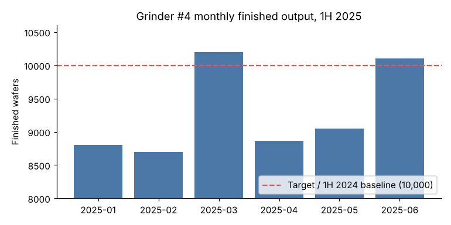
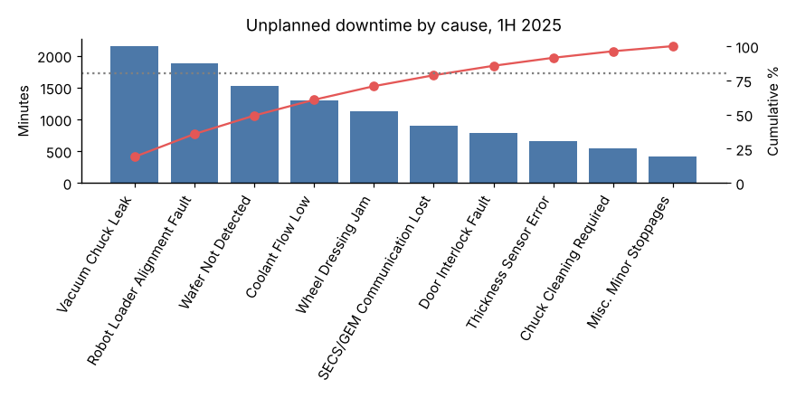

# Restoring Grinder #4 Wafer Output: a DMAIC Analysis

**Lean Six Sigma Green Belt capstone (Georgia Tech).** The scenario is based on a throughout problem I came across while in semiconductor wafer-manufacturing, and **all data is simulated**. This repo reproduces the Measure and Analyze phases in Python.



## Business problem
Finished output from Grinder #4 fell from **~10,000 wafers/month (1H 2024)** to **9,300 wafers/month (1H 2025)**. At ~$50 internal value per wafer, every 1,000-wafer shortfall costs roughly **$50,000/month**.

**Goal:** restore output to ≥10,000 wafers/month for 3 consecutive months, without increasing breakage or fail-spec rates.

## Approach
| Phase | What was done |
|---|---|
| Define | Problem and goal statements, CTQs, operational definition of output (MES "Grind Complete – Pass") |
| Measure | Data-quality checks (completeness, valid ranges, daily-to-monthly reconciliation); wafer-level DPMO and sigma level |
| Analyze | Pareto of downtime causes; simple and multiple regression on 181 days of data; Welch's t-test for shift effect |
| Improve / Control | Costed recommendations and control-plan metrics |

## Key findings
- **Baseline capability:** 3.31% of processed wafers were broken or failed spec (DPMO ≈ 33,000, **≈ 3.3σ**).
- **Operator shift** is the largest driver: night shift produces **~42 fewer wafers/day** (Welch's t-test p < 0.001, Cohen's d ≈ 0.9).
- **Unplanned downtime** reduces output by **~0.5 wafers per minute**, but this only shows up once shift is controlled for (simple regression p ≈ 0.13; multiple regression p ≈ 0.006). **Vacuum-related faults** are 2 of the top 3 downtime causes.
- **Wheel age, calibration age and changeover time** are not significant, either alone or together.
- The model explains about a quarter of daily variation (R² ≈ 0.23), so unmeasured factors also matter.



## Recommendations
1. **Vacuum system:** full leak check, replace worn seals and tubing, add a monthly vacuum integrity check to preventive maintenance (~$1,000–1,200 one-off).
2. **Night-shift error-proofing:** MES auto-verification at job start (poka-yoke) and automated wafer inspection to reduce manual visual checks.
3. **Non-significant Xs:** no targeted action on wheel age, calibration age or changeover; keep them under standard preventive maintenance.
4. **Control:** monthly output on a control chart against the 10,000 target; weekly vacuum-alarm counts and shift-level output as leading indicators.

## Limitations
- Simulated data; the scenario is illustrative and the recommendations were not implemented.
- Daily records sum to 1–4 wafers fewer than the monthly report in four months (<0.05%). This is flagged in the notebook's data-quality checks.
- Each day in the dataset is attributed to a single shift; a real study would record output per shift.
- Regression on observational data shows association, not causation. Validate changes with a pilot.

## Repository structure
```
Data/        simulated daily, monthly and downtime datasets (CSV)
notebooks/   dmaic_analysis.ipynb: full analysis with outputs
figures/     figures used in this README
docs/        project presentation (PDF)
```

## How to run
```bash
pip install -r requirements.txt
jupyter notebook notebooks/dmaic_analysis.ipynb
```
